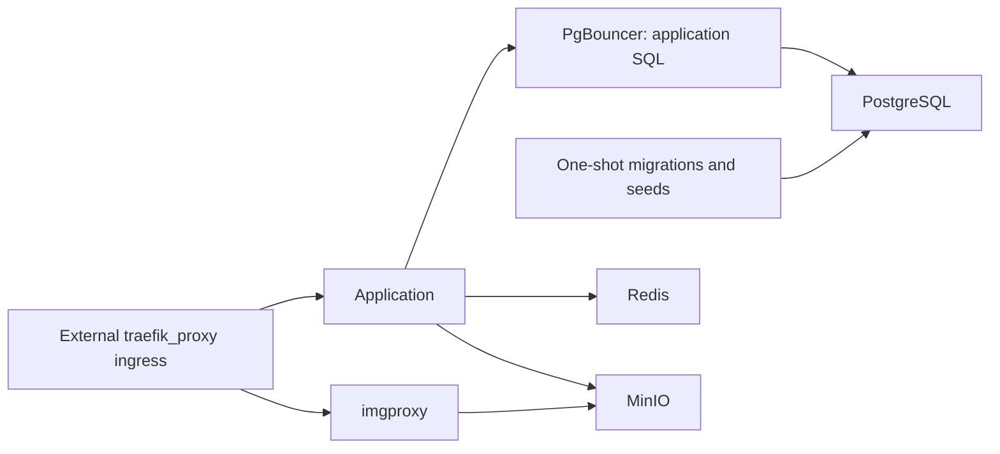

# Infrastructure and configuration

The [project infrastructure contract](../.agents/rules/infrastructure.md) owns configuration names/modules, native client instances and service readiness checks. Apply shared [typed configuration](/../memory/.agents/skills/languages/typescript/references/application-configuration.md), [Bun boundaries](/../memory/.agents/skills/languages/typescript/references/bun.md) and [runtime](/../memory/rules/runtime.md) for reusable configuration, credentials and transport discipline. [Database connections](../.agents/rules/database.md#connections-and-migrations) owns the application/PgBouncer versus direct migration endpoints.

## Images and object storage

MinIO supplies development object storage. `minio-init` creates the application and public buckets idempotently. imgproxy joins the MinIO network and allows only the configured `s3://<bucket>/` source.

The current server image backend signs a URL from a validated bucket-relative key using Bun cryptography. Solid `Picture` receives the resolved image model. Switching to ImageKit changes the backend binding; [Solid UI boundaries](/../memory/.agents/skills/frameworks/tanstack-solid-start/references/ui-boundaries.md) owns presentation/provider separation and private signing.

## Compose topology

`docker-compose.yaml` includes app, PostgreSQL/PgBouncer, Redis, MinIO and imgproxy service files. Each include declares its internal network; ingress services join external `traefik_proxy`, and container application traffic uses `.lokal` aliases. The application consumes `env_file`, with Compose overriding internal service endpoints.

The one-shot migration service points both PostgreSQL URLs at `postgres.lokal`, applies committed migrations, runs deterministic seeds and exits. The long-running application uses `pgbouncer.lokal`.



## Container build

`Dockerfile.bun` installs with the pinned Bun image, runs the production build and starts `.output/server/index.mjs` as the non-root Bun user. Private environment is mounted as a BuildKit secret; only `VITE_APP_NAME` is a public build argument. Dependencies resolve from the application context and pinned remote sources, without sibling repository build contexts.

## Commands

```sh
docker compose config
docker compose up -d --build
docker compose ps
docker compose logs app
```

The external `traefik_proxy` network and configured environment must exist before startup. Existing `.env.example` setup is not a scoped exception to the shared tracked development configuration contract; apply the [project configuration guidance](../.agents/rules/infrastructure.md#configuration) during setup work.
