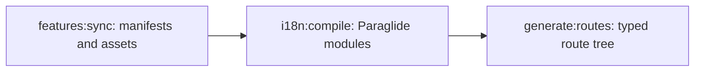

# Tooling and verification

Use shared [Bun process boundaries](/../memory/.agents/skills/languages/typescript/references/bun.md), [Solid UI assessment](/../memory/.agents/skills/frameworks/tanstack-solid-start/references/ui-boundaries.md), [SQL fixture guidance](/../memory/.agents/skills/data/drizzle/references/migrations-and-fixtures.md) and [formatter/hook setup](/../memory/.agents/skills/workflow/project-bootstrap/references/formatting.md). This document owns the template's selected tools and executable entrypoints.

## Test selection

|Source or contract|Selected check|
|-|-|
|Colocated `*.test.ts` schemas, discovery/renderers, server/use cases, SQL compilation, config and adapters|`bun run test:unit`|
|Colocated Solid `*.test.tsx` interactions/accessibility in `src/app` and `src/feat`|`bun run test:ui` with Vitest, jsdom and Solid Testing Library|
|Committed migration behavior in `drizzle/migrations.test.ts`|`bun run test:migrations` with Vitest and PGlite|
|Complete selected suite|`bun run test`|

Vitest executes through Bun 1.4. The migration file selects its non-DOM `node` environment; that environment name does not select Node.js as the runtime. Node.js is not part of this project's toolchain. Discovery/generator tests use temporary directories and check stale-output removal. Query-builder tests keep inert expected SQL in colocated `*.test.sql` fixtures under the shared normalization contract.

## Formatter ownership

Biome owns TS/JS/TSX/JSX and recognized Tailwind calls; Prettier owns SQL, shell, Markdown, JSON and YAML. `bun run format` applies both; `bun run format:check` checks their configured coverage.

Prettier excludes generated `drizzle/*/{migration.sql,snapshot.json}` and Inlang cache/metadata/README output. Authored SQL fixtures and `project.inlang/settings.json` remain formatted. [Repository generated-file ownership](../.agents/rules/repository.md#generated-files) supplies the artifact inventory.

## Generation

`bun run generate` is the pre-build/pre-typecheck entrypoint:



Feature sync emits concern-specific navigation, profile, seed, metadata, virtual-route and JSON-catalog outputs. Their source/ownership contracts live in [feature rules](../.agents/rules/features.md) and the repository generated-file inventory.

## Hooks and commit messages

```sh
bun x lefthook install
bun run hooks:check
bun run commitlint --edit .git/COMMIT_EDITMSG
```

`lefthook.yml` runs staged Biome/Prettier fixes and the complete suite at pre-commit. Pre-push runs repository formatting, tests, typechecking, infrastructure validation and migration-journal validation. `commit-msg` passes the proposed message file to commitlint with `@commitlint/config-conventional`; `commitlint.config.test.ts` invokes the real CLI with an accepted and rejected message.

## Verification commands

```sh
bun run test:unit
bun run test:ui
bun run test:migrations
bun run test
bun run typecheck
bun run format:check
bun run commitlint --edit .git/COMMIT_EDITMSG
bun run verify
bun run build
```

`verify` covers formatting, tests, TypeScript, the migration journal and hook configuration. The production build is an additional gate for framework, route, dependency, configuration, server, i18n or generated-source changes. The pinned TypeScript 7 dependency supplies native `tsc` for `typecheck` and `build`; do not substitute a TypeScript 6 compatibility binary.
